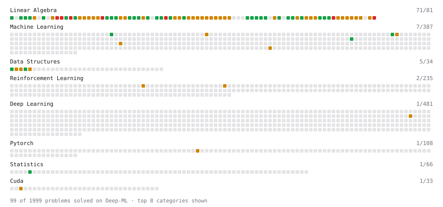

# Deep-ML

My machine learning practice from [Deep-ML](https://www.deep-ml.com). Every solution here was written by hand.

**Completed:** Calculus (9/9)

**61** solved · 56 problems · 0 labs · 5 math

[**Browse the interactive portfolio**](https://gprashant-src.github.io/deep-ml/) to replay this filling in over time.

## Problems

| | Difficulty | Solved | |
| --- | --- | --- | --- |
| [Derivative of a Polynomial](https://www.deep-ml.com/problems/116) | easy | 2026-08-01 | [solution](problems/0116-derivative-of-a-polynomial) |
| [Empirical Probability Mass Function (PMF)](https://www.deep-ml.com/problems/184) | easy | 2026-11-02 | [solution](problems/0184-empirical-probability-mass-function-pmf) |
| [Gradient Direction and Magnitude](https://www.deep-ml.com/problems/308) | easy | 2026-08-01 | [solution](problems/0308-gradient-direction-and-magnitude) |
| [Label Encoding for Ordinal Variables](https://www.deep-ml.com/problems/356) | easy | 2026-10-29 | [solution](problems/0356-label-encoding-for-ordinal-variables) |
| [Matrix-Vector Dot Product](https://www.deep-ml.com/problems/1) | easy | 2026-08-01 | [solution](problems/0001-matrix-vector-dot-product) |
| [Min-Max Scaling of Feature Values](https://www.deep-ml.com/problems/112) | easy | 2026-10-29 | [solution](problems/0112-min-max-scaling-of-feature-values) |
| [Rejection Sampling Best-of-K Selection](https://www.deep-ml.com/problems/768) | easy | 2026-10-30 | [solution](problems/0768-rejection-sampling-best-of-k-selection) |
| [Reshape Matrix](https://www.deep-ml.com/problems/3) | easy | 2026-08-03 | [solution](problems/0003-reshape-matrix) |
| [Tensor Puzzle: Reverse a Vector](https://www.deep-ml.com/problems/1278) | easy | 2026-11-01 | [solution](problems/1278-tensor-puzzle-reverse-a-vector) |
| [2D Translation Matrix Implementation](https://www.deep-ml.com/problems/55) | medium | 2026-10-30 | [solution](problems/0055-2d-translation-matrix-implementation) |
| [Analyze Singular Value Spectrum to Determine Intrinsic Rank](https://www.deep-ml.com/problems/876) | medium | 2026-11-02 | [solution](problems/0876-analyze-singular-value-spectrum-to-determine-intrinsic-rank) |
| [Bellman Expectation Equation for Action-Value Function](https://www.deep-ml.com/problems/465) | medium | 2026-10-31 | [solution](problems/0465-bellman-expectation-equation-for-action-value-function) |
| [Calculate Correlation Matrix](https://www.deep-ml.com/problems/37) | medium | 2026-10-30 | [solution](problems/0037-calculate-correlation-matrix) |
| [Calculate Eigenvalues of a Matrix](https://www.deep-ml.com/problems/6) | medium | 2026-10-29 | [solution](problems/0006-calculate-eigenvalues-of-a-matrix) |
| [Chain Rule for Composite Functions](https://www.deep-ml.com/problems/214) | medium | 2026-10-28 | [solution](problems/0214-chain-rule-for-composite-functions) |
| [Check if Matrix is Positive Definite](https://www.deep-ml.com/problems/332) | medium | 2026-11-01 | [solution](problems/0332-check-if-matrix-is-positive-definite) |
| [Cholesky Decomposition](https://www.deep-ml.com/problems/334) | medium | 2026-11-01 | [solution](problems/0334-cholesky-decomposition) |
| [Compute Grassmann Distance Between Subspaces](https://www.deep-ml.com/problems/875) | medium | 2026-11-02 | [solution](problems/0875-compute-grassmann-distance-between-subspaces) |
| [Compute Normalized Subspace Similarity Between Low-Rank Matrices](https://www.deep-ml.com/problems/868) | medium | 2026-11-02 | [solution](problems/0868-compute-normalized-subspace-similarity-between-low-rank-matrices) |
| [Compute Orthonormal Basis for 2D Vectors](https://www.deep-ml.com/problems/117) | medium | 2026-11-01 | [solution](problems/0117-compute-orthonormal-basis-for-2d-vectors) |
| [Compute the Null Space (Kernel) of a Matrix](https://www.deep-ml.com/problems/330) | medium | 2026-11-01 | [solution](problems/0330-compute-the-null-space-kernel-of-a-matrix) |
| [Create Composite Hypervector for a Dataset Row](https://www.deep-ml.com/problems/74) | medium | 2026-11-01 | [solution](problems/0074-create-composite-hypervector-for-a-dataset-row) |
| [Derivative of Cross-Entropy Loss w.r.t. Logits](https://www.deep-ml.com/problems/220) | medium | 2026-10-28 | [solution](problems/0220-derivative-of-cross-entropy-loss-w-r-t-logits) |
| [Derivative of Softmax](https://www.deep-ml.com/problems/219) | medium | 2026-10-28 | [solution](problems/0219-derivative-of-softmax) |
| [Effective Rank of a Representation Matrix](https://www.deep-ml.com/problems/1376) | medium | 2026-11-03 | [solution](problems/1376-effective-rank-of-a-representation-matrix) |
| [Find Captain Redbeard's Hidden Treasure](https://www.deep-ml.com/problems/127) | medium | 2026-10-28 | [solution](problems/0127-find-captain-redbeard-s-hidden-treasure) |
| [Find the column space of a matrix](https://www.deep-ml.com/problems/68) | medium | 2026-11-01 | [solution](problems/0068-find-the-column-space-of-a-matrix) |
| [Gauss-Seidel Method for Solving Linear Systems](https://www.deep-ml.com/problems/57) | medium | 2026-10-30 | [solution](problems/0057-gauss-seidel-method-for-solving-linear-systems) |
| [Gaussian Elimination for Solving Linear Systems](https://www.deep-ml.com/problems/58) | medium | 2026-10-30 | [solution](problems/0058-gaussian-elimination-for-solving-linear-systems) |
| [Handle Imbalanced Data with SMOTE](https://www.deep-ml.com/problems/357) | medium | 2026-10-29 | [solution](problems/0357-handle-imbalanced-data-with-smote) |
| [Handle Missing Data with Imputation](https://www.deep-ml.com/problems/354) | medium | 2026-10-29 | [solution](problems/0354-handle-missing-data-with-imputation) |
| [Hutchinson Trace and Frobenius Estimators from a Matvec Oracle](https://www.deep-ml.com/problems/1778) | medium | 2026-11-05 | [solution](problems/1778-hutchinson-trace-and-frobenius-estimators-from-a-matvec-oracle) |
| [Image Segmentation via K-Means Clustering](https://www.deep-ml.com/problems/832) | medium | 2026-11-04 | [solution](problems/0832-image-segmentation-via-k-means-clustering) |
| [Implement Reduced Row Echelon Form (RREF) Function](https://www.deep-ml.com/problems/48) | medium | 2026-10-30 | [solution](problems/0048-implement-reduced-row-echelon-form-rref-function) |
| [Jacobian Matrix Calculation](https://www.deep-ml.com/problems/202) | medium | 2026-10-28 | [solution](problems/0202-jacobian-matrix-calculation) |
| [Log-Probability Ratio for Token Sequences](https://www.deep-ml.com/problems/489) | medium | 2026-11-02 | [solution](problems/0489-log-probability-ratio-for-token-sequences) |
| [LU Decomposition of a Square Matrix](https://www.deep-ml.com/problems/333) | medium | 2026-11-01 | [solution](problems/0333-lu-decomposition-of-a-square-matrix) |
| [Matrix Rank](https://www.deep-ml.com/problems/329) | medium | 2026-11-01 | [solution](problems/0329-matrix-rank) |
| [Newton-Schulz Iteration for Approximate Orthogonalization](https://www.deep-ml.com/problems/739) | medium | 2026-11-02 | [solution](problems/0739-newton-schulz-iteration-for-approximate-orthogonalization) |
| [Newton's Method for Optimization](https://www.deep-ml.com/problems/221) | medium | 2026-10-28 | [solution](problems/0221-newton-s-method-for-optimization) |
| [Outlier Detection and Removal Using IQR Method](https://www.deep-ml.com/problems/355) | medium | 2026-10-29 | [solution](problems/0355-outlier-detection-and-removal-using-iqr-method) |
| [Parallel Reduction (Block Sum) CUDA Kernel](https://www.deep-ml.com/problems/1189) | medium | 2026-11-03 | [solution](problems/1189-parallel-reduction-block-sum-cuda-kernel) |
| [Partial Derivatives of Multivariable Functions](https://www.deep-ml.com/problems/215) | medium | 2026-10-28 | [solution](problems/0215-partial-derivatives-of-multivariable-functions) |
| [PCA and ZCA Whitening](https://www.deep-ml.com/problems/1773) | medium | 2026-11-04 | [solution](problems/1773-pca-and-zca-whitening) |
| [Product Rule for Derivatives](https://www.deep-ml.com/problems/309) | medium | 2026-08-02 | [solution](problems/0309-product-rule-for-derivatives) |
| [Quotient Rule for Derivatives](https://www.deep-ml.com/problems/312) | medium | 2026-08-02 | [solution](problems/0312-quotient-rule-for-derivatives) |
| [Sinkhorn-Knopp Doubly Stochastic Projection](https://www.deep-ml.com/problems/732) | medium | 2026-11-01 | [solution](problems/0732-sinkhorn-knopp-doubly-stochastic-projection) |
| [Solve Linear Equations using Jacobi Method](https://www.deep-ml.com/problems/11) | medium | 2026-10-30 | [solution](problems/0011-solve-linear-equations-using-jacobi-method) |
| [Subspace Amplification of Pretrained Weights by a Low-Rank Update](https://www.deep-ml.com/problems/869) | medium | 2026-11-02 | [solution](problems/0869-subspace-amplification-of-pretrained-weights-by-a-low-rank-update) |
| [Tensor Puzzle: Bincount by Scatter-Add](https://www.deep-ml.com/problems/1282) | medium | 2026-11-02 | [solution](problems/1282-tensor-puzzle-bincount-by-scatter-add) |
| [Tensor Puzzle: Compress — Keep True Positions](https://www.deep-ml.com/problems/1279) | medium | 2026-11-02 | [solution](problems/1279-tensor-puzzle-compress-keep-true-positions) |
| [Tensor Puzzle: Cumulative Sum via Triangular Matmul](https://www.deep-ml.com/problems/1274) | medium | 2026-11-02 | [solution](problems/1274-tensor-puzzle-cumulative-sum-via-triangular-matmul) |
| [Tensor Puzzle: Scatter-Add into Bins](https://www.deep-ml.com/problems/1283) | medium | 2026-11-02 | [solution](problems/1283-tensor-puzzle-scatter-add-into-bins) |
| [Top-k Eigenpairs by Power Iteration with Deflation](https://www.deep-ml.com/problems/1772) | medium | 2026-11-03 | [solution](problems/1772-top-k-eigenpairs-by-power-iteration-with-deflation) |
| [Truncated SVD Rank-r Approximation of Weight Updates](https://www.deep-ml.com/problems/872) | medium | 2026-11-02 | [solution](problems/0872-truncated-svd-rank-r-approximation-of-weight-updates) |
| [Woodbury, Sherman-Morrison and the Determinant Lemma](https://www.deep-ml.com/problems/1774) | medium | 2026-11-04 | [solution](problems/1774-woodbury-sherman-morrison-and-the-determinant-lemma) |

## Math

| | Difficulty | Solved | |
| --- | --- | --- | --- |
| [Derivatives and Gradients](https://www.deep-ml.com/math-problems/1) | easy | 2026-08-01 | [solution](math/0001-derivatives-and-gradients) |
| [Matrix Basics](https://www.deep-ml.com/math-problems/9) | easy | 2026-08-10 | [solution](math/0009-matrix-basics) |
| [Vector Operations](https://www.deep-ml.com/math-problems/7) | easy | 2026-08-10 | [solution](math/0007-vector-operations) |
| [Matrix Multiplication](https://www.deep-ml.com/math-problems/10) | medium | 2026-08-10 | [solution](math/0010-matrix-multiplication) |
| [Multivariate Calculus](https://www.deep-ml.com/math-problems/2) | medium | 2026-08-02 | [solution](math/0002-multivariate-calculus) |

---

_This file is regenerated by Deep-ML on every push._
